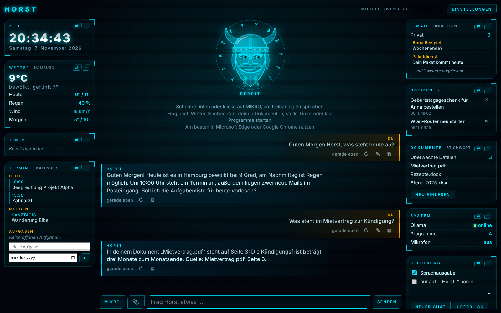
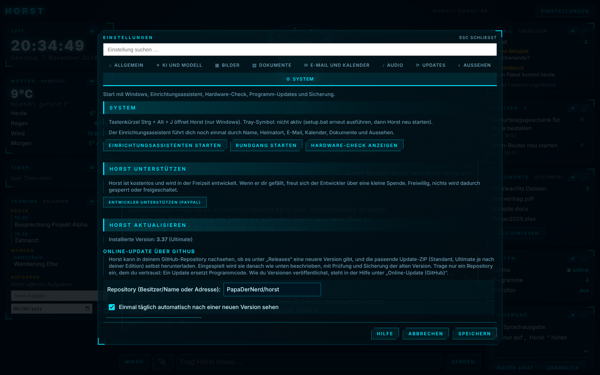
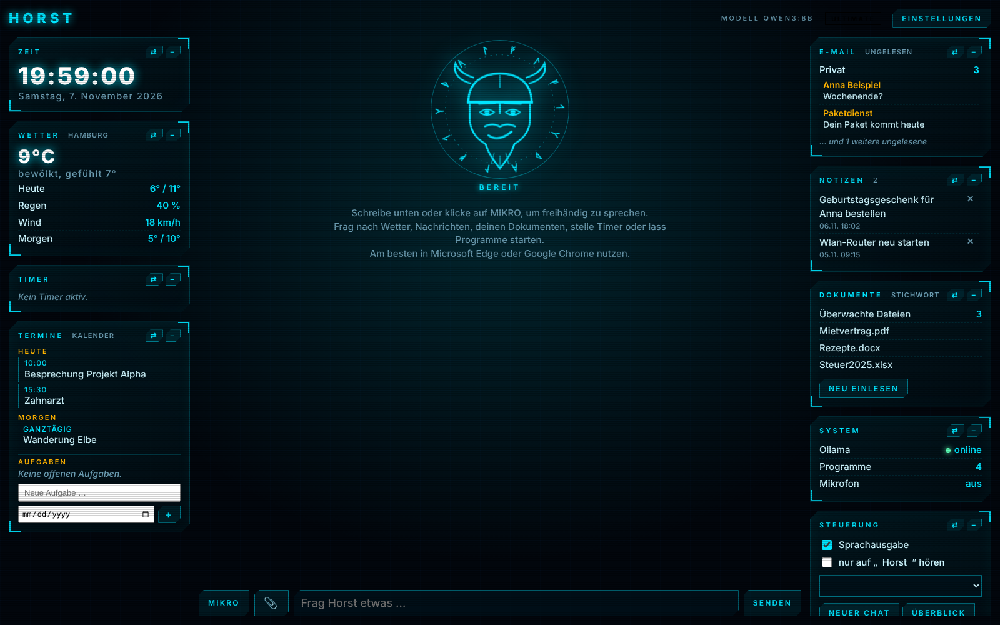

# Horst

**English** | [Deutsch](#deutsch)

Horst is a personal AI assistant for Windows with a sci-fi interface and a Nordic Viking face that reacts to what you do. It runs on your own PC with a local language model (Ollama or LM Studio, your choice), so your documents, notes and conversations stay on your machine. You talk or type to it, and it answers, looks things up and gets things done.

## Why Horst? Honestly: no good reason.
Formerly this project was called "Jarvis", like about a thousand other assistants. There are good ones out there, for example [isair/jarvis](https://github.com/isair/jarvis) (voice first, macOS/Windows/Linux, memory, MCP, dictation in any app) or [llm-guy/jarvis](https://github.com/llm-guy/jarvis) (a compact wake-word demo with Ollama). Horst does not do anything better than them. Maybe a bit differently:

- **Windows first, easy to install:** unzip, run the installer, done. No terminal needed.
- **Your own documents** (PDF, Word, Excel, scans) with the source named in the answer.
- **Everyday stuff in one screen:** weather, news, timers, notes, calendar and mail overview.
- **Ultimate:** edit Excel and Word files, images, optional cloud models.
- **German and English** from the start.
- **A face** that follows your mouse, looks along while you type and grins when you say "thanks".

What Horst does not have (yet): macOS and Linux, MCP. We are tinkering on the **ultimate Horst** and see what is possible, with Northern German composure: "Muss ja. Läuft."

*(Why the name? Jarvis sounds like a butler for a billionaire in an iron suit. This assistant lives on an ordinary PC in the north of Germany. Everybody knows a Horst: reliable, a bit grumpy, never in a hurry, and he gets it done anyway. He wears a Viking helmet and says "Moin".)*

## A hobby project
Horst is a spare-time project, built for fun. Ideas and suggestions are very welcome, just open an [issue](../../issues) or write me. And if you find a bug: you may keep it :) or, even better, tell me about it kindly and I will try to squash it.

## Try it
Horst is **free**. There are two editions:
- **Standard**: the easy start. Chat and voice, questions about your documents, weather, news, timers, notes, calendar and mail overview, web search with sources, reading the screen and more.
- **Horst Ultimate**: everything in Standard plus cloud models as an option (Claude, Gemini, OpenAI), image generation, creating and editing Excel, Word and PowerPoint files, uploading files and images, and more.

1. Download `Horst-Standard-Setup.zip` or `Horst-Ultimate-Setup.zip` from the [latest release](../../releases/latest).
2. Unzip it and run `INSTALLIEREN.bat` (the guide in the package explains the rest).
3. Install [Ollama](https://ollama.com) if you do not have it yet; the setup wizard helps you pick a model. Prefer a window to pick models in? Use [LM Studio](https://lmstudio.ai) instead: in Horst, Settings, "Local engine", and the button "Start LM Studio" does the rest.

To remove Horst again, run `DEINSTALLIEREN.bat` in the Horst folder. It asks whether your data should stay and whether Ollama, LM Studio, Tesseract and Python should be removed too.

## What Horst can do
- **Chat and voice:** speak or type, answers can be read aloud (local Piper voice or browser voices).
- **Your documents:** ask questions about your own files (PDF, Word, Excel, text, scans with OCR) and get answers with the source.
- **Everyday helper:** weather and rain radar, news, timers, notes, tasks, calendar and mail overview, launching programs, media and volume control.
- **Web search** with clickable sources.
- **LM Studio supported:** besides Ollama, LM Studio can compute the answers too (all local).
- **Morning briefing and long-term memory** (Horst remembers facts when you allow it).
- **Read the screen** on request (OCR).
- **Your own layout:** the "Layout" button lets you resize columns and windows, or switch to "Free" and place every window and the chat wherever you like (snaps to a grid, saved automatically).
- **Batch image editing (Ultimate):** upload several images at once and give one instruction for all: resize, crop, rotate, brightness, black and white or convert the format, done locally in seconds. Content edits with Gemini or restyling with ComfyUI work for the whole batch too. The originals stay unchanged.
- **A face with moods:** the Viking follows your mouse, looks along while you type and reacts to listening, thinking, speaking and warnings. Say "thanks" and he grins. Now and then he winks.
- Available in German and English. Help, setup wizard, hardware check and a model recommendation list are built in.

## Online update
In Horst open Settings > System > Online update via GitHub. The repository `PapaDerNerd/horst` is prefilled. Horst looks for a newer release once a day, downloads the package for your edition and installs it with a backup of the old version. Standard users can switch to Ultimate there with "Download Ultimate". The model recommendations (`modelle.json`) are fetched from this repository as validated data only.

## Support
Horst is free and developed in spare time. If you like him, you can buy the developer a coffee (or a bigger helmet): [paypal.me/papadernerd](https://paypal.me/papadernerd). Voluntary, nothing is locked or unlocked by it.

## Privacy
Horst runs locally. Nothing is sent to the cloud unless you switch on a cloud model yourself (Ultimate).

---

# Deutsch

Horst ist ein persönlicher KI-Assistent für Windows mit Sci-Fi-Oberfläche und einem nordischen Wikingergesicht, das auf dein Tun reagiert. Er läuft auf deinem eigenen PC mit einem lokalen Sprachmodell (Ollama oder LM Studio, du hast die Wahl), deine Dokumente, Notizen und Gespräche bleiben also auf deinem Rechner. Du sprichst oder schreibst mit ihm, und er antwortet, schlägt nach und erledigt Dinge.

## Warum Horst? Eigentlich gar nicht.
Früher hieß das Projekt „Jarvis“, wie etwa tausend andere Assistenten auch. Es gibt gute da draußen, zum Beispiel [isair/jarvis](https://github.com/isair/jarvis) (Sprache zuerst, macOS/Windows/Linux, Gedächtnis, MCP, Diktat in jeder App) oder [llm-guy/jarvis](https://github.com/llm-guy/jarvis) (eine kompakte Weckwort-Demo mit Ollama). Horst macht nichts besser als die. Vielleicht ein bisschen anders:

- **Windows zuerst, einfach zu installieren:** entpacken, Installer starten, fertig. Kein Terminal nötig.
- **Deine eigenen Dokumente** (PDF, Word, Excel, Scans), mit Quelle in der Antwort.
- **Alltagskram auf einem Bildschirm:** Wetter, Nachrichten, Timer, Notizen, Kalender- und Mailübersicht.
- **Ultimate:** Excel- und Word-Dateien ändern, Bilder, optionale Cloud-Modelle.
- **Deutsch und Englisch** von Anfang an.
- **Ein Gesicht**, das der Maus folgt, beim Tippen mitschaut und grinst, wenn du „danke“ sagst.

Was Horst (noch) nicht kann: macOS und Linux, MCP. Wir basteln am **ultimativen Horst** und schauen, was möglich ist, mit norddeutscher Gelassenheit: „Muss ja. Läuft.“

*(Und der Name? Jarvis klingt nach Butler für einen Milliardär im Eisenanzug. Dieser Assistent wohnt auf einem ganz normalen PC im Norden Deutschlands. Jeder kennt einen Horst: zuverlässig, ein bisschen brummig, nie in Eile, und am Ende ist es trotzdem erledigt. Er trägt einen Wikingerhelm und sagt „Moin“.)*

## Ein Freizeitprojekt
Horst ist ein Freizeitprojekt, aus Spaß an der Sache entstanden. Ideen und Anregungen sind herzlich willkommen, öffne einfach ein [Issue](../../issues) oder schreib mir. Und wenn du einen Bug findest: Du darfst ihn behalten :) oder, noch besser, mir freundlich Bescheid geben, dann versuche ich, ihn zu erledigen.

## Ausprobieren
Horst ist **kostenlos**. Es gibt zwei Editionen:
- **Standard**: der einfache Einstieg. Chat und Sprache, Fragen zu deinen Dokumenten, Wetter, Nachrichten, Timer, Notizen, Kalender- und Mailübersicht, Websuche mit Quellen, Bildschirm lesen und mehr.
- **Horst Ultimate**: alles aus Standard, dazu Cloud-Modelle als Option (Claude, Gemini, OpenAI), Bilder erzeugen, Excel-, Word- und PowerPoint-Dateien erstellen und ändern, Dateien und Bilder hochladen und mehr.

1. Lade `Horst-Standard-Setup.zip` oder `Horst-Ultimate-Setup.zip` aus dem [neuesten Release](../../releases/latest) herunter.
2. Entpacke die ZIP-Datei und starte `INSTALLIEREN.bat` (die Anleitung im Paket erklärt den Rest).
3. Installiere [Ollama](https://ollama.com), falls noch nicht vorhanden; der Einrichtungsassistent hilft bei der Modellwahl. Lieber ein Programm mit Fenster zur Modellauswahl? Dann nimm [LM Studio](https://lmstudio.ai): in Horst unter Einstellungen „Lokale Engine“, der Knopf „LM Studio starten“ erledigt den Rest.

Zum Entfernen startest du `DEINSTALLIEREN.bat` im Horst-Ordner. Sie fragt, ob deine Daten bleiben sollen und ob auch Ollama, LM Studio, Tesseract und Python entfernt werden.

## Was Horst kann
- **Chat und Sprache:** sprechen oder schreiben, Antworten auf Wunsch vorgelesen (lokale Piper-Stimme oder Browser-Stimmen).
- **Deine Dokumente:** Fragen zu eigenen Dateien (PDF, Word, Excel, Text, Scans mit OCR), Antworten mit Quelle.
- **Alltagshelfer:** Wetter und Regenradar, Nachrichten, Timer, Notizen, Aufgaben, Kalender- und Mailübersicht, Programme starten, Medien- und Lautstärkesteuerung.
- **Websuche** mit anklickbaren Quellen.
- **LM Studio unterstützt:** neben Ollama kann auch LM Studio die Antworten berechnen (alles lokal).
- **Morgenbericht und Langzeitgedächtnis** (Horst merkt sich Fakten, wenn du es erlaubst).
- **Bildschirm lesen** auf Wunsch (OCR).
- **Eigenes Layout:** Mit dem Knopf „Layout“ änderst du Spaltenbreite und Fensterhöhe oder schaltest auf „Frei“ und platzierst jedes Fenster und den Chat, wo du willst (rastet am Raster ein, wird automatisch gespeichert).
- **Bilder im Stapel bearbeiten (Ultimate):** mehrere Bilder auf einmal hochladen und eine Anweisung für alle geben: verkleinern, zuschneiden, drehen, Helligkeit, schwarz-weiß oder Format umwandeln, lokal in Sekunden. Inhaltliche Änderungen mit Gemini oder Umgestalten mit ComfyUI gehen ebenfalls für den ganzen Stapel. Die Originale bleiben unverändert.
- **Ein Gesicht mit Launen:** Der Wikinger folgt deiner Maus, schaut beim Tippen mit und reagiert auf Zuhören, Denken, Sprechen und Warnungen. Sag „danke“, und er grinst. Ab und zu zwinkert er.
- Auf Deutsch und Englisch. Hilfe, Einrichtungsassistent, Hardware-Check und eine Liste mit Modellempfehlungen sind eingebaut.

## Online-Update
In Horst: Einstellungen > System > Online-Update über GitHub. Das Repository `PapaDerNerd/horst` ist vorausgefüllt. Horst sucht einmal täglich nach einer neueren Version, lädt das Paket für deine Edition herunter und installiert es mit Sicherung der alten Version. Wer Standard nutzt, kann dort mit „Ultimate herunterladen“ wechseln. Die Modellempfehlungen (`modelle.json`) kommen aus diesem Repository, nur als geprüfte Daten.

## Unterstützen
Horst ist kostenlos und entsteht in der Freizeit. Wenn er dir gefällt, spendier dem Entwickler einen Kaffee (oder einen größeren Helm): [paypal.me/papadernerd](https://paypal.me/papadernerd). Freiwillig, nichts wird dadurch gesperrt oder freigeschaltet.

## Datenschutz
Horst läuft lokal. Nichts geht in die Cloud, solange du nicht selbst ein Cloud-Modell einschaltest (Ultimate).
